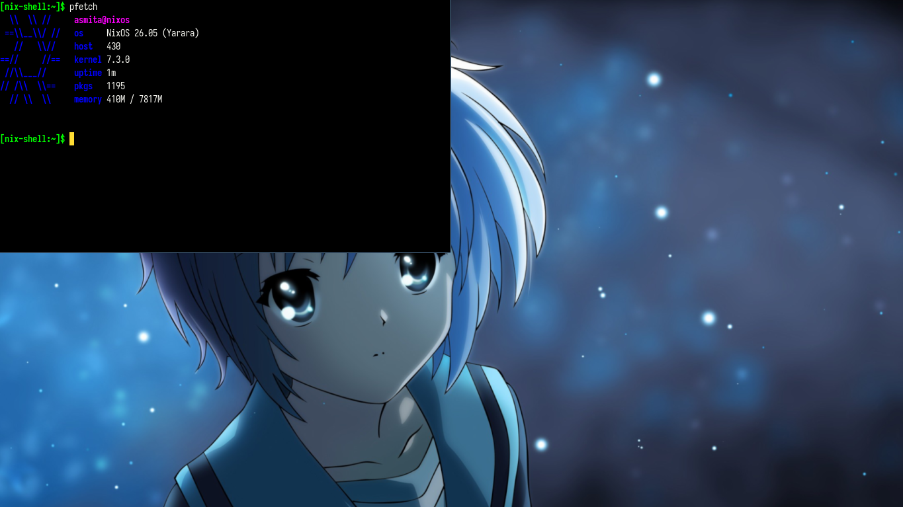

# adachi

A minimal tiling window manager for X11, built around Ratpoison-style frames

## Key bindings

Press `Ctrl+t`, release it, then press:

- `c`: open `xterm`
- `d`: open `dmenu_run`
- `n` or `Space`: show the next hidden window in the current frame
- `p`: show the previous hidden window in the current frame
- `t`: show the last window
- `1`-`9`: switch workspace
- `Shift+1`-`Shift+9`: move the current window to a workspace
- `k`: close the current window
- `q`: quit Adachi

Frames:

- `s`: split the current frame into top and bottom
- `S`: split the current frame into left and right
- `Tab`: focus the next frame
- `Left`, `Right`, `Up`, `Down`: focus the frame in that direction
- `r`: resize the current frame, then use the arrow keys and press any other key to finish
- `Q`: keep only the current frame
- `R`: remove the current frame

